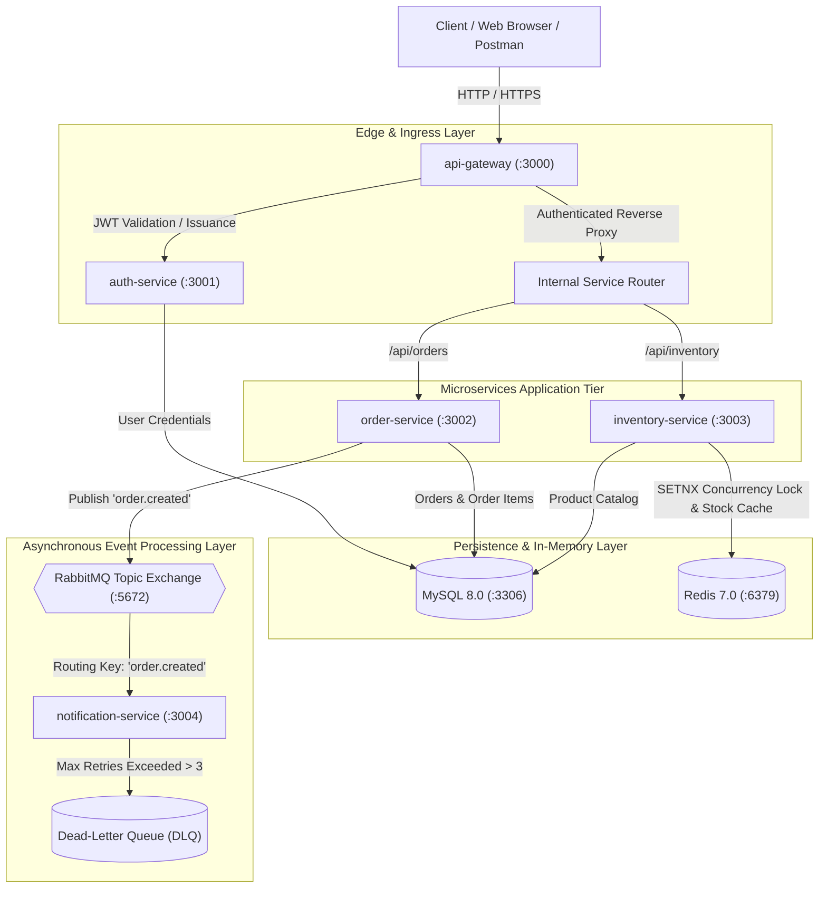
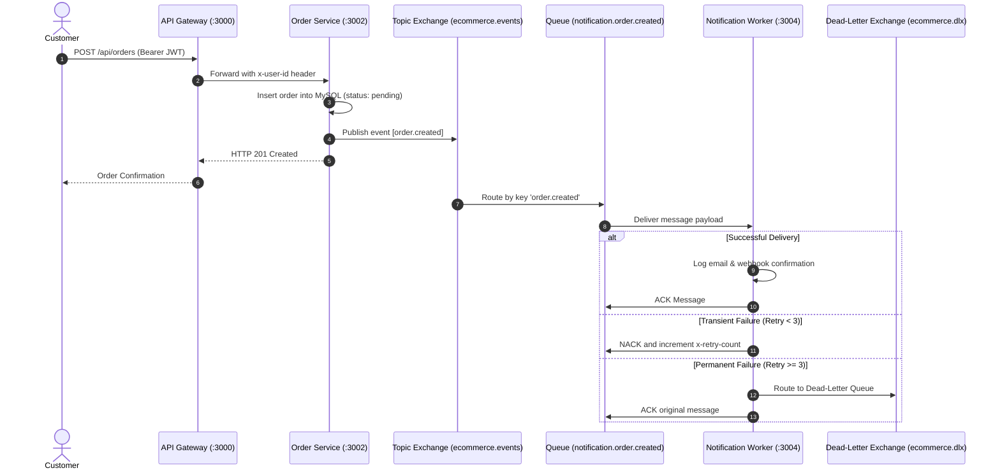

# Distributed E-Commerce Order & Inventory Engine
## Production Microservices Architecture & DevOps Technical Specification

---

## 1. Executive Summary

The **Distributed E-Commerce Order & Inventory Engine** is an enterprise-grade cloud-native platform engineered to demonstrate high-concurrency order processing, event-driven decoupling, and containerized DevOps practices.

The platform splits core commercial responsibilities across five distinct microservices and three foundational infrastructure components. Rather than relying on traditional monolithic database locking, it leverages **Redis distributed locks** for concurrency control and **RabbitMQ topic exchanges** for asynchronous background event processing.



---

## 2. Real-World Problem & Business Use Cases

### 2.1 The "Flash Sale" Concurrency Challenge
When high volumes of users concurrently attempt to purchase constrained inventory (e.g., ticket releases, seasonal sales, limited tech drops), standard relational database architectures suffer from:
1. **Row-Level Lock Contention**: Severe latency spikes as hundreds of concurrent threads wait on the same database rows.
2. **Race Conditions & Overselling**: Inability of simple `SELECT` then `UPDATE` statements to prevent negative stock counts without heavy table locks.
3. **Deadlocks**: Multiple items in carts being updated in different sequences across parallel transactions.

### 2.2 The Solution in this Engine
1. **Atomic Distributed Locks with Redis**:
   - The `inventory-service` executes lock acquisition using Redis `SET resource_key token EX 10 NX`.
   - Critical sections are locked per-product, not globally.
   - Lock release is atomic using Lua scripts comparing token ownership, preventing accidental release by stalled threads.
   - Resource sorting prevents cross-item deadlocks when multi-item orders are processed.

2. **Decoupled Asynchronous Checkout**:
   - The `order-service` completes checkout operations within milliseconds by writing the order transaction to MySQL and immediately publishing an `order.created` event.
   - Time-consuming tasks (invoice generation, transactional email delivery, CRM webhooks) are completely decoupled into the autonomous `notification-service`.

3. **Centralized Edge Protection**:
   - Downstream services remain unexposed to the public internet.
   - The `api-gateway` enforces token validation, IP rate limiting (100 requests per 15-minute window), and distributes W3C OpenTelemetry headers (`traceparent`, `x-request-id`).

---

## 3. Microservices Inventory & Component Specifications

| Service | Technology | Port | Responsibilities | Data Dependencies |
| :--- | :--- | :--- | :--- | :--- |
| **`api-gateway`** | Node.js 20, Express, `http-proxy-middleware` | `3000` | Ingress gateway, rate-limiting, JWT signature verification, OpenTelemetry propagation, Web Dashboard UI. | In-memory token validation |
| **`auth-service`** | Node.js 20, Express, `bcryptjs`, `jsonwebtoken` | `3001` | User registration, password hashing (10 salt rounds), JWT signing (HS256, 24h expiration). | MySQL (`users` table) |
| **`order-service`** | Node.js 20, Express, `amqplib`, `mysql2` | `3002` | Cart checkout validation, order persistence, AMQP event publication (`ecommerce.events`). | MySQL (`orders`, `order_items`), RabbitMQ |
| **`inventory-service`** | Node.js 20, Express, `ioredis`, `mysql2` | `3003` | Stock maintenance, atomic reservations via Redis distributed lock, stock caching (60s TTL). | MySQL (`products` table), Redis 7 |
| **`notification-service`** | Node.js 20, `amqplib` (Background Worker) | `3004` | Consumer worker for `order.created` events, email and webhook simulation, retry counter, DLQ routing. | RabbitMQ (`notification.order.created`) |
| **`mysql`** | Oracle MySQL Community Server | `3306` | ACID relational store for user credentials, catalog products, and orders. | Local volume: `mysql-data` |
| **`redis`** | Redis Alpine | `6379` | In-memory caching layer and sub-millisecond distributed lock manager. | Local volume: `redis-data` |
| **`rabbitmq`** | RabbitMQ with Management Plugin | `5672`, `15672` | AMQP 0-9-1 message broker with topic exchanges and dead-letter routing. | Local volume: `rabbitmq-data` |

---

## 4. API Specification & Endpoints

All external HTTP requests route through the **API Gateway** on port `3000`.

### 4.1 Authentication Endpoints
- **`POST /api/auth/register`**
  - **Payload**: `{"name": "string", "email": "string", "password": "string"}`
  - **Response (201)**: `{"id": 1, "email": "user@example.com", "name": "string"}`
- **`POST /api/auth/login`**
  - **Payload**: `{"email": "string", "password": "string"}`
  - **Response (200)**: `{"token": "<JWT_STRING>", "user": {"id": 1, "email": "...", "name": "..."}}`

### 4.2 Inventory Endpoints (JWT Guarded)
- **`GET /api/inventory`**
  - **Headers**: `Authorization: Bearer <TOKEN>`
  - **Query Params**: `?page=1&limit=20`
  - **Response (200)**: `{"products": [...], "pagination": {"total": 5, "page": 1, "totalPages": 1}}`
- **`POST /api/inventory/seed`**
  - **Headers**: `Authorization: Bearer <TOKEN>`
  - **Response (200)**: `{"message": "Sample inventory seeded successfully", "count": 5}`

### 4.3 Order Endpoints (JWT Guarded)
- **`POST /api/orders`**
  - **Headers**: `Authorization: Bearer <TOKEN>`
  - **Payload**: `{"items": [{"productId": 1, "quantity": 2, "price": 29.99}]}`
  - **Response (201)**: `{"id": 1, "userId": 1, "total": 59.98, "status": "pending", "items": [...]}`
  - *Side Effect*: Publishes payload to `ecommerce.events` topic exchange with key `order.created`.
- **`GET /api/orders`**
  - **Headers**: `Authorization: Bearer <TOKEN>`
  - **Response (200)**: `{"orders": [...], "pagination": {...}}`

---

## 5. Message Broker Topology & Dead-Letter Exchange



---

## 6. Container & Kubernetes Architecture

### 6.1 Multi-Stage Dockerfile Pattern
Every microservice uses the following multi-stage Alpine pattern running under an unprivileged user:
```dockerfile
FROM node:20-alpine AS builder
WORKDIR /app
COPY package*.json ./
RUN if [ -f package-lock.json ]; then npm ci --omit=dev; else npm install --omit=dev; fi
COPY . .

FROM node:20-alpine
RUN addgroup -g 1001 appgroup && adduser -u 1001 -G appgroup -D appuser
WORKDIR /app
COPY --from=builder /app .
USER appuser
EXPOSE <PORT>
CMD ["node", "src/index.js"]
```

### 6.2 Kubernetes Helm Chart Hierarchy (`deploy/helm/`)
```
deploy/helm/ecommerce-platform/
├── Chart.yaml                  # Umbrella chart definition (v1.0.0)
├── values.yaml                 # Global parameters & subchart overrides
├── templates/
│   ├── _helpers.tpl            # Template helpers
│   ├── namespace.yaml          # Dedicated namespace definition
│   ├── secrets.yaml            # Shared database credentials & JWT keys
│   └── NOTES.txt               # Post-installation instructions
└── charts/                     # Independent Subcharts
    ├── api-gateway/            # Deployment, Service, ConfigMap, HPA
    ├── auth-service/           # Deployment, Service, ConfigMap, HPA
    ├── order-service/          # Deployment, Service, ConfigMap, HPA
    ├── inventory-service/      # Deployment, Service, ConfigMap, HPA
    ├── notification-service/   # Deployment, Service, ConfigMap, HPA
    ├── mysql/                  # StatefulSet with 1Gi PVC
    ├── redis/                  # Deployment with 1Gi PVC
    └── rabbitmq/               # StatefulSet with Management Console
```

---

## 7. Live Deployment & Operational Access

### 7.1 EC2 Host Configuration
- **Host Public IPv4**: `32.236.235.235`
- **Instance Operating System**: Ubuntu 24.04 LTS
- **Memory Configuration**: 3.7 GiB RAM + 2.0 GiB Swap (`/swapfile`)

### 7.2 Service Access Links

| Interface | URL | Credentials / Notes |
| :--- | :--- | :--- |
| **Interactive Web Application** | [http://32.236.235.235:3000](http://32.236.235.235:3000) | Full SPA for auth, inventory, ordering, and live tracing |
| **RabbitMQ Management Portal** | [http://32.236.235.235:15672](http://32.236.235.235:15672) | **User**: `guest` / **Password**: `guest` |
| **API Gateway Healthcheck** | [http://32.236.235.235:3000/healthz](http://32.236.235.235:3000/healthz) | Returns `{"status":"ok"}` |
| **Git Repository** | [GitHub Repository](https://github.com/Abhish7899/ecommerce-microservices-devops) | Branches: `main`, `test`, `testing` |
