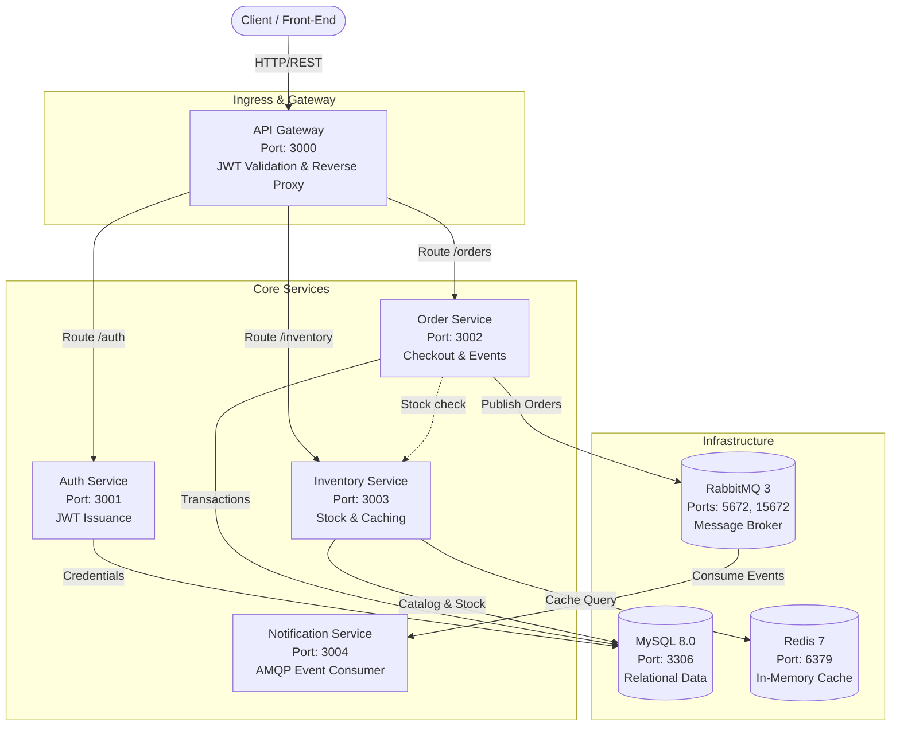

# E-Commerce Microservices Platform Infrastructure

Production-grade cloud-native infrastructure for an enterprise E-Commerce microservices platform, fully configured for both local containerized development with **Docker Compose** and scalable orchestration with **Kubernetes & Helm**.

---

## 1. System Architecture

The platform follows a decoupled, resilient microservices architecture orchestrated with service discovery, centralized routing, caching, and asynchronous messaging.



---

## 2. Microservice & Infrastructure Directory

| Service | Port | Type | Core Role | Data / Broker Dependencies | Health Check |
| :--- | :---: | :---: | :--- | :--- | :--- |
| **api-gateway** | `3000` | Gateway | Routes requests, validates JWT tokens | auth, order, inventory | `curl http://localhost:3000/healthz` |
| **auth-service** | `3001` | Microservice | Issues JWTs, manages users | MySQL 8.0 | `curl http://localhost:3001/healthz` |
| **order-service** | `3002` | Microservice | Manages cart & checkout processing | MySQL 8.0, RabbitMQ 3 | `curl http://localhost:3002/healthz` |
| **inventory-service** | `3003` | Microservice | Stock levels and product availability | MySQL 8.0, Redis 7 | `curl http://localhost:3003/healthz` |
| **notification-service** | `3004` | Worker | Consumes order events and sends alerts | RabbitMQ 3 | `curl http://localhost:3004/healthz` |
| **mysql** | `3306` | Database | Relational database (persistence) | Named volume `mysql-data` | `mysqladmin ping` |
| **redis** | `6379` | Cache | Low-latency in-memory data store | Named volume `redis-data` | `redis-cli ping` |
| **rabbitmq** | `5672`<br/>`15672` | Message Broker | AMQP message broker & Management UI | Named volume `rabbitmq-data` | `rabbitmq-diagnostics -q ping` |

---

## 3. Local Development with Docker Compose

The `docker-compose.yml` file provides a turn-key environment with strict startup dependencies, custom health checks, resource limits, and persistent storage.

### Prerequisites
- Docker Engine 24.0+ and Docker Compose v2.20+

### Quick Start

1. **Configure Environment Variables**:
   Copy the example environment template:
   ```bash
   cp .env.example .env
   ```
   *(Review and modify `.env` if custom ports or passwords are required).*

2. **Launch the Entire Stack**:
   ```bash
   docker compose up -d --build
   ```

3. **Verify Service Health Status**:
   Every service includes a configured healthcheck and strict `depends_on` conditions (`service_healthy`):
   ```bash
   docker compose ps
   ```
   All services will show `healthy` status once initialized.

4. **Stream Logs**:
   ```bash
   # Stream all logs
   docker compose logs -f

   # Stream specific service logs
   docker compose logs -f api-gateway auth-service
   ```

5. **Stop and Clean Up**:
   ```bash
   # Stop containers preserving volumes
   docker compose down

   # Stop and remove all persistent volumes and networks
   docker compose down -v
   ```

---

## 4. Kubernetes Deployment with Helm

Production deployment is fully packaged under `deploy/helm/ecommerce-platform/`.

### Chart Hierarchy

```
deploy/helm/ecommerce-platform/
├── Chart.yaml                  # Parent chart with subchart dependencies
├── values.yaml                 # Global parameters and subchart overrides
├── templates/
│   ├── _helpers.tpl            # Common labels and naming helpers
│   ├── namespace.yaml          # Target namespace creation
│   ├── secrets.yaml            # Shared secrets (JWT_SECRET, DB passwords)
│   └── NOTES.txt               # Post-deployment access manual
└── charts/                     # Subcharts directory
    ├── api-gateway/            # Deployment, Service, ConfigMap, HPA
    ├── auth-service/           # Deployment, Service, ConfigMap, HPA
    ├── order-service/          # Deployment, Service, ConfigMap, HPA
    ├── inventory-service/      # Deployment, Service, ConfigMap, HPA
    ├── notification-service/   # Deployment, Service, ConfigMap, HPA
    ├── mysql/                  # StatefulSet, Service, ConfigMap, 1Gi PVC
    ├── redis/                  # Deployment, Service, ConfigMap, 1Gi PVC
    └── rabbitmq/               # StatefulSet, Service, ConfigMap, 1Gi PVC
```

### Installation

1. **Deploy to Kubernetes Cluster**:
   ```bash
   helm install ecommerce-release ./deploy/helm/ecommerce-platform \
     --namespace ecommerce \
     --create-namespace
   ```

2. **Verify Pods and Workloads**:
   ```bash
   kubectl get pods,svc,pvc,hpa -n ecommerce
   ```

3. **Accessing Services via Port Forwarding**:
   - **API Gateway**:
     ```bash
     kubectl port-forward -n ecommerce svc/ecommerce-release-api-gateway 3000:3000
     # Test endpoint:
     curl http://localhost:3000/healthz
     ```
   - **RabbitMQ Management Dashboard**:
     ```bash
     kubectl port-forward -n ecommerce svc/ecommerce-release-rabbitmq 15672:15672
     # Open browser at: http://localhost:15672 (user: guest / pass: guest)
     ```
   - **MySQL Database**:
     ```bash
     kubectl port-forward -n ecommerce svc/ecommerce-release-mysql 3306:3306
     ```
   - **Redis Cache**:
     ```bash
     kubectl port-forward -n ecommerce svc/ecommerce-release-redis 6379:6379
     ```

4. **Horizontal Pod Autoscaling (HPA)**:
   All application microservices have Horizontal Pod Autoscalers enabled by default (min: 2, max: 10, target CPU: 70%):
   ```bash
   kubectl get hpa -n ecommerce
   ```

5. **Upgrades and Configuration Customization**:
   Pass values inline or provide a custom values file:
   ```bash
   helm upgrade ecommerce-release ./deploy/helm/ecommerce-platform \
     --namespace ecommerce \
     --set api-gateway.replicaCount=3 \
     --set global.jwtSecret="your-production-jwt-secret-key"
   ```

6. **Uninstall**:
   ```bash
   helm uninstall ecommerce-release --namespace ecommerce
   ```

---

## 5. Security & Secret Management

- **Shared Secrets**: The parent chart generates `ecommerce-shared-secrets` containing:
  - `JWT_SECRET`: Shared securely between `api-gateway` and `auth-service`.
  - `MYSQL_ROOT_PASSWORD` & `MYSQL_PASSWORD`: Shared between MySQL and database clients (`auth-service`, `order-service`, `inventory-service`).
  - `RABBITMQ_PASSWORD`: Shared between RabbitMQ and AMQP clients (`order-service`, `notification-service`).
- **Non-Root Execution**: Dockerfiles run as unprivileged `node` user for defense-in-depth container security.
- **Resource Constraints**: CPU and Memory requests and limits are enforced on all services to prevent noisy-neighbor issues and starvation.

Author
Abhishek Dhurwade
